# ai-framework

Framework mínimo e determinístico para orquestrar agentes de IA em um fluxo estruturado:
**Backlog → Triage → Research → Plan → Implement ⇄ Verify → Review → Done**.

Princípio: **menos é mais**. No repositório, o agente sempre carrega apenas o `AGENTS.md` (< 150 linhas) como ponto de entrada; o restante do contexto é lido estritamente sob demanda. A mecânica operacional é executada por scripts CLI; as decisões e julgamentos são conduzidos pelas skills.

---

## Estrutura do Framework

```
aif-init/                    ← Skill global instalável no ambiente do agente
├── SKILL.md                 Orquestra: diagnóstico → entrevista/análise → confirmação → geração
├── references/
│   ├── interview-new.md     Perguntas estruturadas para projeto novo (objetivo → arquitetura → convenções → backlog/MCP)
│   └── analyze-existing.md  Checklist de inferência em projeto existente (código + tarefas locais e MCPs)
├── scripts/aif.mjs          CLI determinístico (detect, init, new, plan, start, done, adr, check, import-tasks…)
└── template/                Estrutura copiada para o projeto
    ├── AGENTS.md            Ponto de entrada do agente (< 150 linhas)
    ├── DESIGN.md            Arquitetura viva, diagramas e invariantes
    ├── docs/adr/            Architecture Decision Records (decisões imutáveis)
    ├── .agents/skills/      Skills das etapas do fluxo (flow-triage, flow-plan, flow-implement, flow-review, verify, adr)
    └── tasks/
        ├── BACKLOG.md       Visão consolidada e status de todas as tarefas
        ├── _templates/      Templates de task.md, spec.md e plan.md
        ├── backlog/         Tarefas aguardando início/refinamento
        ├── active/          Tarefas ativas em andamento (actives: spec, plan, doing, review)
        └── complete/        Tarefas concluídas (histórico e evidências preservados)
```

---

## Instalação (Uma vez)

```powershell
# Para agentes baseados no Antigravity:
node aif-init/scripts/aif.mjs install

# Para agentes baseados no Claude Code:
node aif-init/scripts/aif.mjs install --tool claude
```

---

## Fluxo de Desenvolvimento

```mermaid
flowchart TD
    subgraph S0["0. Inicialização (Sistema Novo ou Existente)"]
        A0["Repositório do Projeto"] --> B0["Comando: /aif-init"]
        B0 --> C0["Diagnóstico + Entrevista / Análise<br/>(Se houver backlog local, copia automaticamente)"]
        C0 --> D0["Gera: AGENTS.md + DESIGN.md + ADRs + tasks/{backlog,active,complete}"]
    end

    subgraph S1["Ciclo de Desenvolvimento de Feature"]
        direction TB
        E["Demanda / Bug / Ideia"] --> F["1. Triage: /flow-triage"]
        F -->|aif new| G["tasks/backlog/<id>-<slug>/<br/>• task.md + spec.md<br/>• Linha no BACKLOG.md<br/>• Registro no site via MCP (se houver)"]

        G --> H["2. Research & Plan: /flow-plan <id>"]
        H -->|aif start / plan| I["Move para tasks/active/<id>-<slug>/<br/>Cria branch feat/<id>-<slug><br/>Preenche spec.md"]

        I --> J{"Gate 1: Humano aprova spec.md?"}
        J -- Não --> I
        J -- Sim --> K["Gera plan.md<br/>(Passos + Contrato de Verificação)"]

        K --> L["3. Implementação: /flow-implement <id>"]
        L --> M["Loop TDD / Commits pequenos<br/>Status MCP: In Progress"]
        M --> N["Skill: /verify (Testes e verificações)"]

        N -->|Falhou| M
        N -->|Passou| O["Abre Pull Request"]

        O --> P["4. Pré-Revisão: /flow-review <id>"]
        P --> Q["Gera tasks/active/<id>-<slug>/review.md"]

        Q --> R{"Gate 2: Revisão Humana & Merge na main"}
        R -- Ajustes --> M
        R -- Aprovado e Mergeado --> S["5. Conclusão: aif done <id>"]

        S --> T["Move para tasks/complete/<id>-<slug>/<br/>(Histórico e evidências preservados)<br/>Apaga branch/worktree local<br/>Fecha card no site via MCP<br/>Status BACKLOG.md → done"]
    end

    D0 --> E
```



---

## Etapas Explicadas: O que faz e como executar

### 0. Inicialização do Projeto
* **O que faz:** Inicializa o framework no repositório. Em projetos novos, conduz uma entrevista concisa (objetivo, arquitetura, convenções e backlog/MCP). Em projetos existentes, analisa o código, detecta comandos e migra tarefas locais prévias se existirem.
* **Comando no chat:**
  ```text
  /aif-init
  ```

---

### 1. Triagem e Criação da Tarefa (`flow-triage`)
* **O que faz:** Recebe uma solicitação, bug ou ideia, classifica tipo (`feature`, `bug`, `chore`, `incident`), tamanho (`S`, `M`, `L`) e prioridade (`P0`, `P1`, `P2`). Cria a pasta da tarefa em `tasks/backlog/<id>-<slug>/` com o arquivo `task.md` e `spec.md`, registra a linha no `tasks/BACKLOG.md` e, se configurado MCP (Linear, GitHub, Jira), registra o card no site.
* **Comando no chat:**
  ```text
  /flow-triage Exportar relatório de auditoria em PDF
  ```
* **Comando CLI equivalente:**
  ```bash
  node .agents/aif.mjs new "Exportar relatório de auditoria em PDF" --type feature --size M --prio P1
  ```

---

### 2. Pesquisa e Planejamento (`flow-plan`)
* **O que faz:** 
  1. Move a tarefa da pasta `tasks/backlog/` para `tasks/active/<id>-<slug>/` e cria a branch `feat/<id>-<slug>`.
  2. Preenche o `spec.md` com intenção, contexto, opções avaliadas e recomendação técnica.
  3. **Gate Humano 1:** Para e aguarda sua aprovação no `spec.md`.
  4. Após o seu "ok", gera o `plan.md` com passos de implementação e o **Contrato de Verificação** (testes e comandos objetivos que comprovam a entrega).
* **Comando no chat:**
  ```text
  /flow-plan 001
  ```
* **Comando CLI equivalente:**
  ```bash
  node .agents/aif.mjs start 001
  node .agents/aif.mjs plan 001
  ```

---

### 3. Implementação e Verificação (`flow-implement`)
* **O que faz:** Executa a implementação estritamente orientada aos passos do `plan.md`. Se houver integração MCP, atualiza o card remoto para "In Progress". Realiza commits atômicos para cada passo, executa a skill `/verify` para validar o Contrato de Verificação e prepara o Pull Request.
* **Comando no chat:**
  ```text
  /flow-implement 001
  ```
* **Verificação isolada a qualquer momento:**
  ```text
  /verify
  ```

---

### 4. Pré-Revisão Automatizada (`flow-review`)
* **O que faz:** O agente atua como revisor técnico independente. Analisa o diff do PR contra o `spec.md` e o `plan.md`, conferindo escopo, riscos, integridade de dados e aderência ao `DESIGN.md`. Gera o relatório `review.md` na pasta ativa indicando o veredito (*aprovar*, *ajustes* ou *bloquear*) com os pontos exatos para você inspecionar.
* **Comando no chat:**
  ```text
  /flow-review 001
  ```

---

### 5. Conclusão e Limpeza (`aif done`)
* **O que faz:** Após você revisar e realizar o merge do PR na branch principal (`main`), esse comando finaliza o ciclo da tarefa:
  1. Move o diretório de `tasks/active/<id>-<slug>/` para `tasks/complete/<id>-<slug>/` (preservando o histórico documental, decisões e evidências de testes).
  2. Atualiza o status no `tasks/BACKLOG.md` para `done`.
  3. Remove a branch local e worktree da feature.
  4. Fecha ou marca como concluída a tarefa no site via MCP (se aplicável).
* **Comando no terminal (na main):**
  ```bash
  node .agents/aif.mjs done 001
  ```

---

## Gestão de Backlog e Subpastas

O framework organiza as tarefas em três estados físicos em disco dentro de `tasks/`:

| Pasta | Finalidade | Status correspondente no `BACKLOG.md` |
|---|---|---|
| `tasks/backlog/` | Tarefas registradas na fila, aguardando início ou detalhamento | `inbox`, `backlog` |
| `tasks/active/` | Tarefas em andamento (com branch aberta, spec, plano e testes) | `research`, `plan`, `todo`, `doing`, `review` |
| `tasks/complete/` | Tarefas concluídas e mergeadas na main (documentação preservada) | `done` |

* **Caso o projeto já tenha tarefas locais:** `aif init` detecta pastas como `.agents/tasks/`, `tasks/`, `planejamento/` ou `TODO.md` e **copia automaticamente** para a estrutura `tasks/`, sem perda de dados.
* **Caso o projeto use MCP ou site externo:** As ferramentas MCP (GitHub Issues, Linear, Jira) são aproveitadas para marcar o status da tarefa no site da ferramenta em cada transição do fluxo.

---

## Exemplo Real de Uso: Criando uma Feature Nova

Imagine que precisamos adicionar a funcionalidade de **Download de Relatório em PDF** (ID `009`) em uma aplicação web:

### 1. Entrada da demanda
Você digita no chat:
```text
/flow-triage Permitir download de relatório analítico em formato PDF
```
**O que acontece:**
- O script cria `tasks/backlog/009-permitir-download-de-relatorio-analitico-em-formato-pdf/task.md` e `spec.md`.
- No `tasks/BACKLOG.md`, uma nova linha é inserida:
  `| 009 | feature | M | P1 | backlog | Permitir download de relatório analítico em formato PDF |`

### 2. Pesquisa e Planejamento
Você comanda:
```text
/flow-plan 009
```
**O que acontece:**
- A pasta é transferida automaticamente para `tasks/active/009-permitir-download-de-relatorio-analitico-em-formato-pdf/`.
- A branch `feat/009-permitir-download-de-relatorio-analitico-em-formato-pdf` é criada e ativada.
- O agente preenche `spec.md` avaliando duas libs (ex: PDFKit vs Puppeteer headless) e recomenda PDFKit.
- O agente solicita: *"Humano, por favor revise o `spec.md` para confirmarmos o uso do PDFKit antes de criar o plano"*.
- Você responde: *"Aprovado, pode seguir com PDFKit"*.
- O agente cria `plan.md` contendo:
  - Passo 1: Instalar dependência e criar service gerador de PDF.
  - Passo 2: Adicionar rota `GET /api/reports/:id/pdf`.
  - Passo 3: Adicionar botão de download na tela de relatórios.
  - **Verificação:** `npm test -- test/pdf.spec.ts` passa; requisição `GET /api/reports/1/pdf` retorna cabeçalho `Content-Type: application/pdf` e status 200.

### 3. Implementação
Você comanda:
```text
/flow-implement 009
```
**O que acontece:**
- O agente implementa cada passo, rodando os testes e criando commits atômicos:
  - `feat(009): implementar serviço gerador de pdf`
  - `feat(009): expor endpoint de download do relatorio`
  - `feat(009): adicionar botao de exportacao no frontend`
- O agente roda `/verify`, certifica-se de que o Contrato de Verificação passou 100% com evidências reais, sobe a branch e abre o Pull Request #14.

### 4. Revisão
Você pede:
```text
/flow-review 009
```
**O que acontece:**
- O agente cria `tasks/active/009-permitir-download-de-relatorio-analitico-em-formato-pdf/review.md`.
- Veredito: **Aprovar**. Destaca que os testes cobrem casos de erro 404 e geração correta do buffer, sem regressões.

### 5. Merge e Finalização
Você faz o merge do PR #14 no GitHub e atualiza a sua branch principal local (`git checkout main && git pull`).
No terminal, você executa:
```bash
node .agents/aif.mjs done 009
```
**O que acontece:**
- A pasta da task é movida para `tasks/complete/009-permitir-download-de-relatorio-analitico-em-formato-pdf/`.
- A branch `feat/009-...` é apagada.
- No `tasks/BACKLOG.md`, o status de `009` muda de `doing` para `done`.
- O histórico completo do planejamento, execução e verificação fica arquivado e organizado no projeto.
