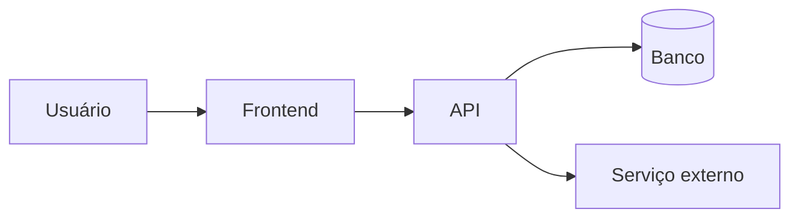

# DESIGN.md

> Fotografia da arquitetura **atual**. Mantenha **< 200 linhas**.
> Só o presente: o "porquê" histórico mora em `docs/adr/`.
> Atualize no mesmo PR que muda a arquitetura.

## Visão geral

<2–4 frases: o que o sistema faz e para quem.>

## Módulos

| Módulo | Caminho | Responsabilidade | Não deve |
|---|---|---|---|
| api | `src/api/` | HTTP, validação de entrada | conter regra de negócio |
| domain | `src/domain/` | regras de negócio puras | importar infra |
| infra | `src/infra/` | banco, filas, clientes externos | ser chamado pela UI |

## Fluxos críticos

1. **<nome do fluxo>:** `api/x` → `domain/y` → `infra/z`. Ver ADR-0002.

## Invariantes

- <ex: todo dinheiro é inteiro em centavos>
- <ex: domain não faz I/O>

## Pontos de atenção

- <ex: módulo legado `src/old/` — não estender, migrar sob demanda>
